<div align="center">


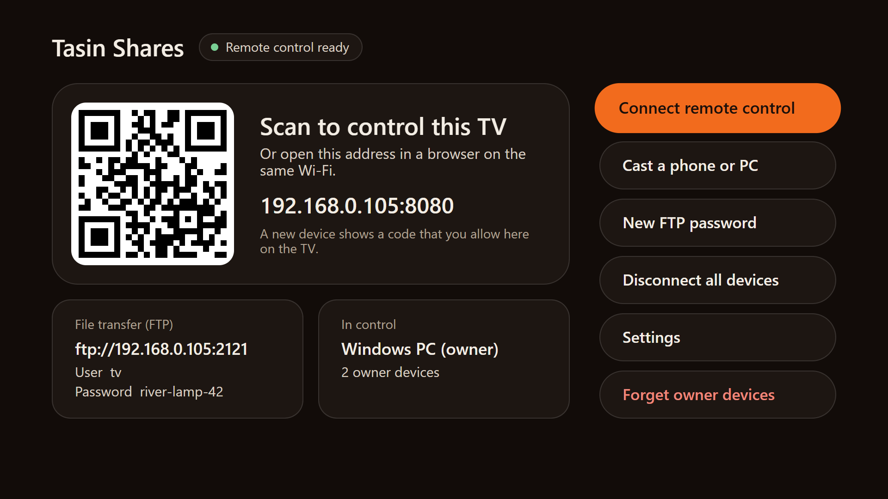

# Tasin Shares

**Control your Google TV from your phone or computer over Wi-Fi.**<br>
A remote, the live TV screen, app launching and file transfer, in any browser. Nothing to install on the phone.

[Download the latest APK](https://github.com/tasin-py/Tasin-Shares/releases/latest) ·
[Features](#features) ·
[Install](#install) ·
[Build from source](#build-from-source) ·
[Support](#support)

</div>

---

## Overview

Tasin Shares runs on the TV and serves a web page on your home network. Scan the QR code on the TV with a phone, or open the address in any browser. The TV shows a pairing code, you allow it on the TV, and that device becomes a full remote control.

Everything stays on your local network: no account, no cloud service and no app store install on the controlling device.

## Features

| | |
|---|---|
| **Remote control** | D-pad, OK, back, home, power, input, volume, mute and media keys. Hold to repeat. Type text straight into the TV, and pop the remote out into its own small window. |
| **Mouse** | A real cursor on the TV, driven from your phone: a trackpad (drag to move, tap twice to click, two fingers to scroll or right-click), Left and Right click keys, and a **gyro mouse** that moves the cursor as you move the phone. |
| **Live TV screen** | Watch the TV's screen in the browser, and control it with your mouse and keyboard. Play the TV's sound on the TV, on your device, or on both. |
| **Apps** | Every installed app as a banner shelf, with search. Open any app in one tap, switch to HDMI, AV or Live TV, and force stop an app with a right-click or a long press. |
| **Files** | Browse the TV's storage, then upload, download, rename, delete or create folders, with drag and drop. Install an APK straight from the file list. A built-in FTP server is there for file managers. |
| **Access control** | New devices need a code that you allow on the TV. One device controls the TV at a time. Owner devices sign in with the owner password, then reconnect without a code and can take over. |
| **On the TV** | A home screen with the QR code, the address, the FTP login and who is in control. Help for casting a phone or PC screen to the TV. Starts with the TV. |
| **Themes** | Ember, Ocean, Forest, Dark and Light, on the TV and per browser. |
| **Updates** | **Check for updates** downloads the newest GitHub release and installs it on the TV. |

## Screenshots

<table>
  <tr>
    <td width="33%">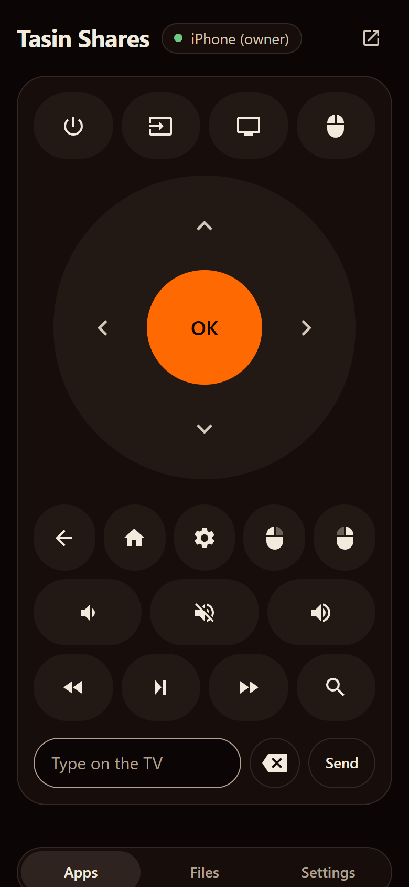</td>
    <td width="33%">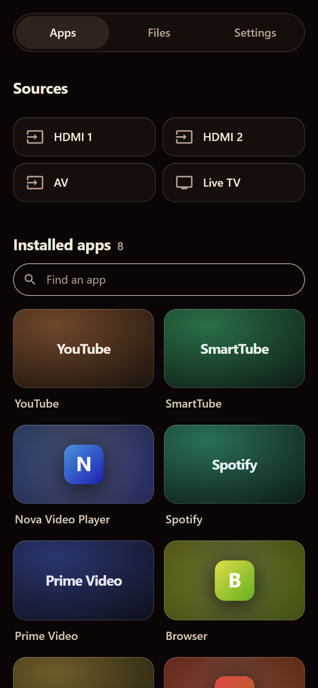</td>
    <td width="33%">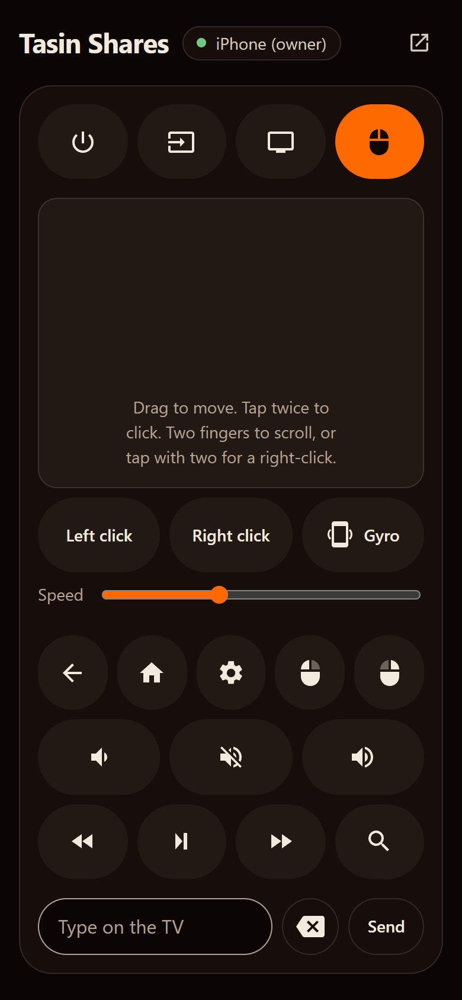</td>
  </tr>
  <tr>
    <td align="center">Remote</td>
    <td align="center">Apps</td>
    <td align="center">Trackpad</td>
  </tr>
  <tr>
    <td>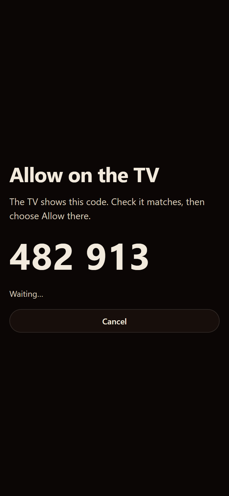</td>
    <td>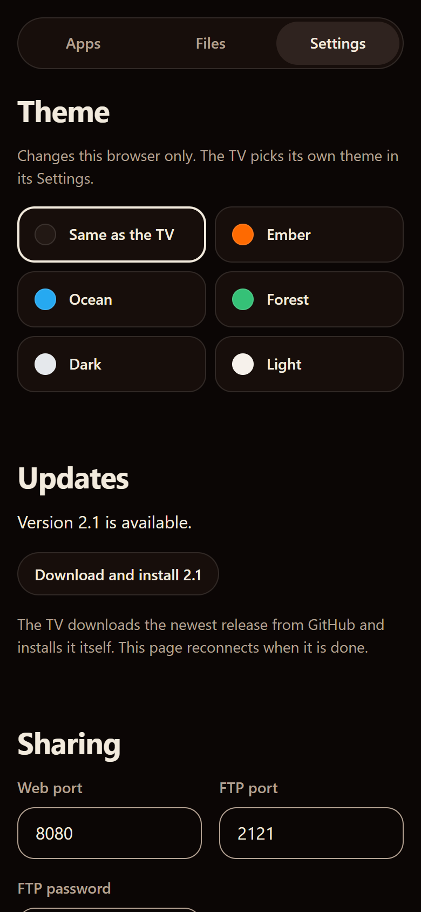</td>
    <td>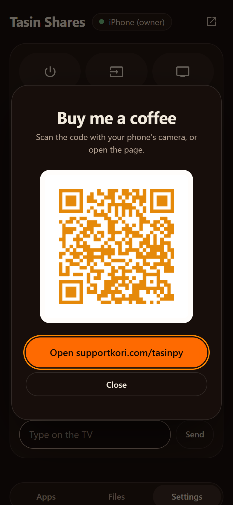</td>
  </tr>
  <tr>
    <td align="center">Pairing code</td>
    <td align="center">Settings</td>
    <td align="center">Support</td>
  </tr>
</table>

**On a computer**

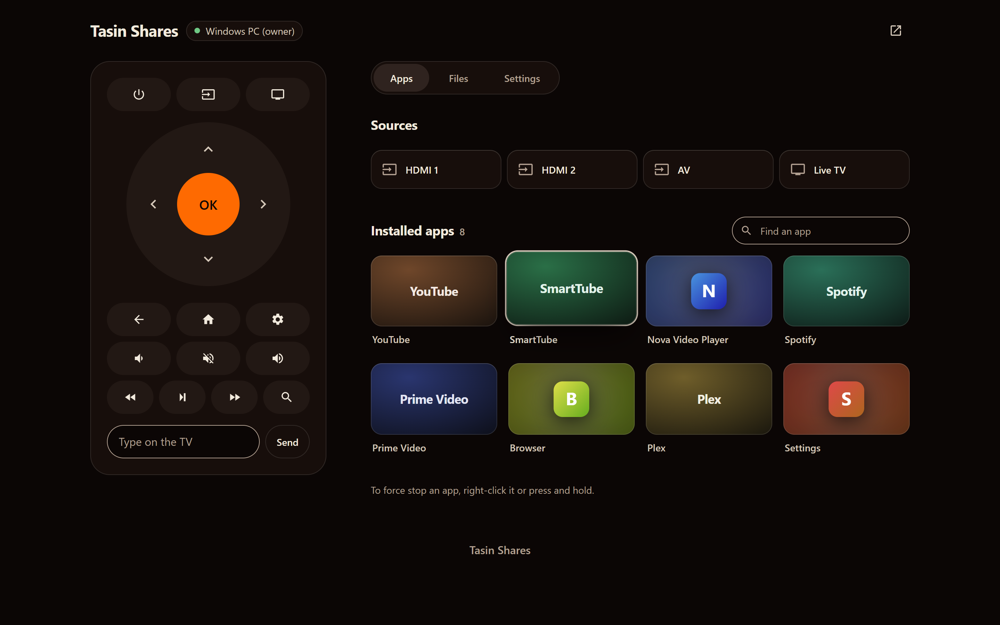

<table>
  <tr>
    <td width="50%">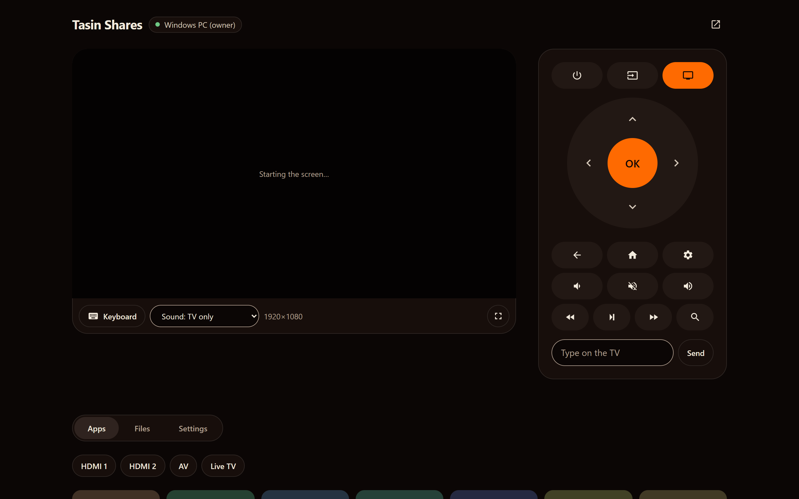</td>
    <td width="50%">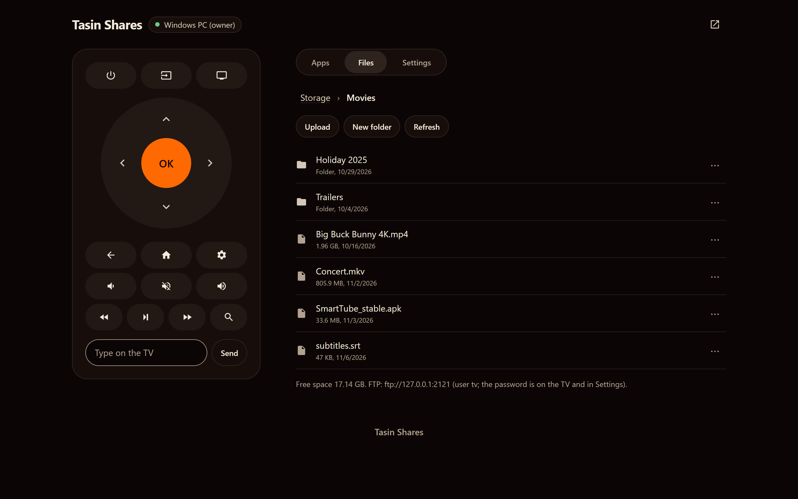</td>
  </tr>
  <tr>
    <td align="center">Live TV screen</td>
    <td align="center">Files</td>
  </tr>
  <tr>
    <td>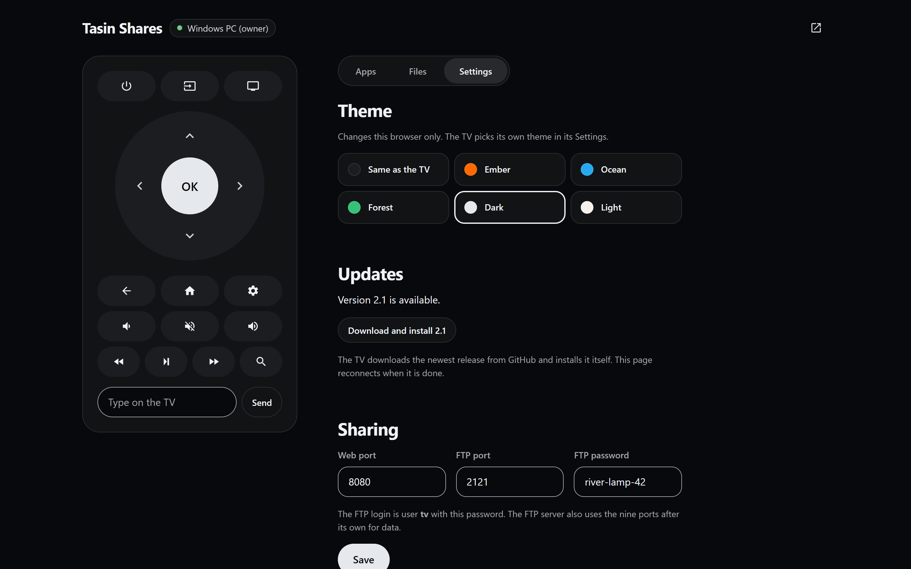</td>
    <td>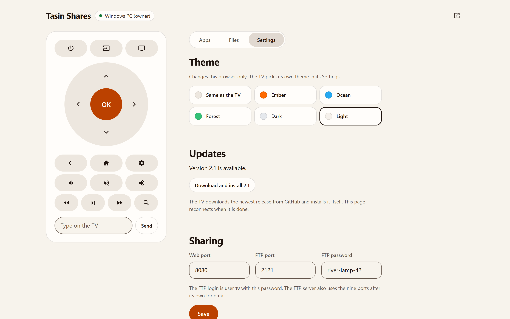</td>
  </tr>
  <tr>
    <td align="center">Dark theme</td>
    <td align="center">Light theme</td>
  </tr>
</table>

**On the TV**

<table>
  <tr>
    <td width="50%"></td>
    <td width="50%">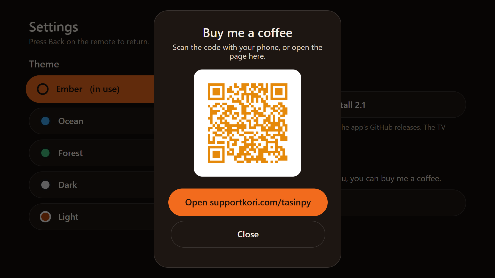</td>
  </tr>
  <tr>
    <td align="center">Home</td>
    <td align="center">Settings</td>
  </tr>
</table>

> The screenshots use sample data, and the app banners are placeholders. On a real TV the shelf shows each app's own banner.

## Requirements

- An **Android TV or Google TV** running Android 8.0 or later.
- **ADB debugging over the network (port 5555)** turned on in the TV's Developer options. Tasin Shares connects to the TV's own ADB to press keys, capture the screen and install apps.
- The TV and the controlling device on the **same Wi-Fi or LAN**.
- Any modern browser on the phone or computer.

**Compatibility**

| Device | Status |
|---|---|
| TCL Google TV | Tested. The extra remote buttons and start at boot are tuned for TCL. |
| Other Android TV / Google TV sets with network ADB on port 5555 | Expected to work. |
| Chromecast with Google TV, Google TV Streamer | Not supported yet. They offer only Wireless debugging with pairing codes, not plain network ADB. |

## Install

### 1. Turn on debugging on the TV

Tasin Shares controls the TV through the TV's own debugging connection (ADB on port 5555). You only set this up once.

1. Open **Settings → System → About**, and select **Android TV OS build** seven times, until the TV says you are a developer.
2. Open **Settings → System → Developer options**, and turn on **USB debugging**.
3. If the list also has **Network debugging** or **ADB over network**, turn that on as well.
4. Note the TV's IP address under **Settings → Network & Internet**.

> **Wireless debugging is not enough on its own.** The Wireless debugging switch on newer TVs uses a pairing code and a random port. Tasin Shares needs the TV to accept connections on port 5555, which USB debugging or Network debugging turns on. That's why Chromecast with Google TV and the Google TV Streamer aren't supported yet.

If debugging is off, the TV's **Connect remote control** button turns into **How to turn on debugging**. It shows these steps, with buttons that open the right Settings screens.

### 2. Install the APK

Download `TasinShares.apk` from the [latest release](https://github.com/tasin-py/Tasin-Shares/releases/latest). Then, from a computer with [ADB](https://developer.android.com/tools/releases/platform-tools) installed:

```bash
adb connect 192.168.0.105:5555
adb install -r TasinShares.apk
adb shell appops set com.tasin.shares MANAGE_EXTERNAL_STORAGE allow
adb shell appops set com.tasin.shares SYSTEM_ALERT_WINDOW allow
adb shell cmd deviceidle whitelist +com.tasin.shares
```

On TCL TVs, also allow start at boot:

```bash
adb shell appops set com.tasin.shares APP_AUTO_START allow
```

From a clone of this repository, `TV_HOST=192.168.0.105 ./install.sh` builds the APK and runs all of the above.

### 3. First run

1. Open **Tasin Shares** on the TV and choose **Connect remote control**.
2. On the **Allow debugging?** prompt, tick **Always allow** and choose **Allow**.
3. Scan the QR code with your phone, or open the address shown on the TV, usually `http://<tv-ip>:8080`. If another app on the TV already uses port 8080, Tasin Shares moves to the next free port and shows that address instead.
4. Allow the code that appears on the TV. You're connected.

> **Tip:** reserve the TV's IP address in your router's DHCP settings, so the address and your bookmarks never change.

## Usage

| Want to | Do this |
|---|---|
| Use the TV with a mouse | Press the mouse key at the top right of the remote. The D-pad turns into a trackpad: drag to move the cursor, tap twice to click, drag two fingers to scroll, and tap with two fingers to right-click. Hold **Left click** while you drag to drag things. The **Left click** and **Right click** keys sit next to Settings on the basic remote too. |
| Use the gyro mouse | In trackpad mode, press **Gyro**. The first time, the page offers the TV's secure page, because phone browsers share the motion sensor only with secure (HTTPS) pages. Your browser warns once, because the TV made its own certificate; choose **Advanced**, then **Proceed**. Then press **Gyro**, point the top of the phone at the TV, and move it. **Speed** sets how far the cursor goes. |
| Search on the TV | Open a search box on the TV, type in **Type on the TV**, and press **Send**. It types the text and presses Enter, so the search runs. **Backspace** next to it deletes on the TV, and holding it repeats. |
| Use the TV with your mouse and keyboard | Press the screen button on the remote, then click into the picture and choose **Keyboard**. |
| Send files to the TV | Open **Files**, go to any folder (Movies, Music, Download and so on), and drop files on the page, or use FTP: `ftp://<tv-ip>:2121`, user `tv`, with the password shown on the TV. |
| Install an app | Upload the APK in **Files**, then choose **Install** from its menu. |
| Show a phone or PC screen on the TV | On the TV, choose **Cast a phone or PC** for steps for Windows, Android and Apple devices. |
| Become the owner | On a new install, the first device you allow can set the owner password in **Settings**, which makes it the owner. Other devices open **I’m the owner** on the connect screen and enter that password. Owner devices reconnect without a code. |
| Change ports or the FTP password | **Settings → Sharing** (owners only). |

## Security

- Tasin Shares is made for a **trusted home network**. The web page and FTP use plain HTTP and FTP, without TLS.
- Every new device needs approval on the TV. Only owner devices can change settings, install updates or take over.
- The owner password is stored only as a salted hash.
- The secure page (for the gyro mouse) uses a certificate the TV makes for itself. Its key stays in the TV's Android keystore; browsers warn once because no public authority signed it.
- **Never forward the web or FTP ports to the internet.**

## Build from source

You need **JDK 17** and the **Android SDK** (platform 34).

```bash
git clone https://github.com/tasin-py/Tasin-Shares.git
cd Tasin-Shares
./gradlew assembleRelease
```

The APK is written to `app/build/outputs/apk/release/TasinShares.apk`.

### Publishing an update

The in-app updater reads the latest release of this repository.

1. Raise `versionCode` and `versionName` in `app/build.gradle`.
2. Build the APK, signed with **the same key** as the copy already installed, or Android refuses the update.
3. Create a GitHub release tagged `v<versionName>` (for example `v2.1`), and attach the file as `TasinShares.apk`.

The updater finds the newest release through GitHub's `releases/latest` link, not the API, so a household of TVs never hits GitHub's API rate limit. It installs through the TV's own ADB without a prompt, or falls back to Android's installer.

## Project structure

```
app/src/main/
├── java/com/tasin/shares/
│   ├── LinkService.java      Foreground service: starts the web and FTP servers at boot
│   ├── WebServer.java        HTTP API and WebSocket (remote, screen, files, settings)
│   ├── Access.java           Pairing codes, sessions, owners and control hand-over
│   ├── Adb.java, AdbClient   Connection to the TV's own ADB
│   ├── ScrcpySession.java    Screen and audio capture through scrcpy-server
│   ├── TvControl.java        Apps, inputs, icons and installs
│   ├── MainActivity.java     The TV home screen
│   ├── SettingsActivity.java Themes, updates and support on the TV
│   ├── Updater.java          GitHub release check, download and install
│   └── Theme.java            The colour themes
└── assets/
    ├── index.html            The web app: remote, screen, apps, files, settings
    └── jmuxer.min.js         Plays the H.264 stream in the browser
```

## Credits

Tasin Shares bundles these open-source components. Details are in [`third_party/README.md`](third_party/README.md).

| Component | Licence | Used for |
|---|---|---|
| [scrcpy](https://github.com/Genymobile/scrcpy) server 5.0.1 | Apache-2.0 | Screen video, audio and input injection |
| [jMuxer](https://github.com/samirkumardas/jmuxer) 2.1.4 | MIT | H.264 playback in the browser |
| [NanoHTTPD](https://github.com/NanoHttpd/nanohttpd) 2.3.1 | BSD-3-Clause | Web server and WebSocket |
| [Apache FtpServer](https://mina.apache.org/ftpserver-project/) 1.2.0 | Apache-2.0 | FTP server |
| [ZXing](https://github.com/zxing/zxing) 3.5.3 | Apache-2.0 | QR codes |
| [Geist](https://github.com/vercel/geist-font) | SIL OFL 1.1 | The lettering in the TV banner |

## Support

If Tasin Shares is useful to you, you can buy me a coffee.

<a href="https://www.supportkori.com/tasinpy"></a>

**[supportkori.com/tasinpy](https://www.supportkori.com/tasinpy)**

---

<div align="center">Made by <a href="https://github.com/tasin-py">Tasin</a></div>
